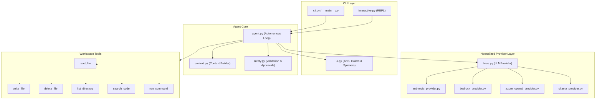

# Coder Agent (`coder-agent`)

> A lightweight, production-ready **AI Coding Agent CLI** inspired by Claude Code and OpenAI Codex CLI. It understands existing codebases, implements multi-file modifications, executes build and test commands, analyzes errors, and self-corrects until tests pass.

---

## Features

- **Multi-Provider LLM Support**: Seamlessly switch between **Anthropic Claude**, **AWS Bedrock**, **Azure OpenAI**, and **Local LLMs (Ollama / LM Studio / vLLM)** through a unified abstraction.
- **Deep Codebase Understanding**: Recursively explores code structure, reads files with line-number slices, performs regex searches, and auto-detects project configurations while ignoring `node_modules`, `.git`, `.venv`, and build artifacts.
- **Safe & Guided Execution**: Path validation blocks directory traversal outside workspace boundaries; shell command blocklist stops dangerous system commands; interactive `[y/N]` confirmation prompts for destructive actions (deletions, command runs, file overwrites).
- **Test-Driven Self-Correction**: Automatically invokes project test runners (`pytest`, `npm test`, `cargo test`, etc.), captures process exit codes and stderr, and iterates on fixes.
- **Real-Time Streaming Terminal UI**: Pure ANSI terminal interface with token streaming, spinners, unified diffs, and structured final execution summaries without heavy external UI dependencies.
- **Dual Operating Modes**: Direct requirement mode for single-command automation and an interactive REPL mode for conversational workflows.

---

## Architecture Overview



---

## Installation

### Prerequisites
- Python 3.11+
- Virtual environment (recommended)

### Setup
```bash
# Clone or navigate to the repository
cd "Coding Agent"

# Create and activate virtual environment
python3 -m venv .venv
source .venv/bin/activate

# Install in editable mode with development dependencies
pip install -e ".[dev]"
```

Verify installation:
```bash
coder-agent --version
# Output: coder-agent 1.0.0
```

---

## Configuration & Provider Setup

Configuration can be provided via environment variables, CLI options, or a `.coder-agent.json` file in your project root. Copy `.env.example` to `.env`:

```bash
cp .env.example .env
```

### 1. Anthropic (Direct API) — Default
```bash
export CODER_AGENT_PROVIDER=anthropic
export ANTHROPIC_API_KEY=sk-ant-api03-...
export CODER_AGENT_MODEL=claude-sonnet-4-20250514  # or claude-3-5-sonnet-latest
```

### 2. AWS Bedrock (Converse API)
```bash
export CODER_AGENT_PROVIDER=bedrock
export AWS_REGION=us-east-1
export AWS_ACCESS_KEY_ID=AKIA...
export AWS_SECRET_ACCESS_KEY=...
export CODER_AGENT_MODEL=anthropic.claude-sonnet-4-20250514-v1:0
```

### 3. Azure OpenAI
```bash
export CODER_AGENT_PROVIDER=azure
export AZURE_OPENAI_ENDPOINT=https://your-resource.openai.azure.com
export AZURE_OPENAI_API_KEY=your-api-key
export AZURE_OPENAI_API_VERSION=2024-10-01-preview
export CODER_AGENT_MODEL=gpt-4o  # Deployment name
```

### 4. Ollama / Local LLM (OpenAI-Compatible)
Make sure Ollama or LM Studio is running locally with a tool-calling model (e.g., `qwen3`, `llama3.3`):
```bash
ollama run qwen3
export CODER_AGENT_PROVIDER=ollama
export OLLAMA_BASE_URL=http://localhost:11434/v1
export CODER_AGENT_MODEL=qwen3
```

---

## Usage

### Direct Command Mode
Execute a single task and view execution progress, diffs, and test results:
```bash
coder-agent "Fix the division by zero bug in calculator.py and ensure tests pass"
```

Run against a specific directory:
```bash
coder-agent --project-dir ./examples/sample_project "Run pytest and fix any failing tests"
```

Select a specific provider or model:
```bash
coder-agent -p bedrock -m anthropic.claude-sonnet-4-20250514-v1:0 "Add type hints to utils/"
```

### Interactive REPL Mode
Launch an interactive session for continuous multi-turn coding:
```bash
coder-agent -i
```

Interactive commands:
- `help` — display available commands
- `config` — inspect active configuration and limits
- `clear` — clear screen
- `exit` or `quit` — exit REPL

---

## Safety & Destructive Action Safeguards

Coder Agent includes built-in safeguards configured via `--approval`:

| Approval Mode | Overwriting Existing Files | Deleting Files | Shell Commands | Creating New Files |
|---|---|---|---|---|
| `destructive` *(default)* | Prompts with diff `[y/N]` | Prompts `[y/N]` | Prompts `[y/N]` | Auto-approved |
| `always` | Prompts `[y/N]` | Prompts `[y/N]` | Prompts `[y/N]` | Prompts `[y/N]` |
| `never` *(CI/Tests)* | Auto-approved | Auto-approved | Auto-approved | Auto-approved |

- **Path Escape Protection**: Paths with `../` or pointing outside the project root are rejected immediately.
- **Dangerous Command Blocklist**: Commands matching `rm -rf /`, `sudo`, `mkfs.`, fork bombs, and raw device writes are blocked before prompting.

---

## Available Tools

The agent interacts with the workspace using six provider-agnostic tools:
1. `read_file`: Reads file content with optional line slices (`start_line`, `end_line`) and line numbers.
2. `write_file`: Creates or modifies files. Shows a unified diff before overwriting.
3. `delete_file`: Deletes files with user confirmation.
4. `list_directory`: Traverses project directory hierarchy, excluding `.git`, `node_modules`, `.venv`, and build caches.
5. `search_code`: Scans files using regex or text patterns, optionally filtered by file globs.
6. `run_command`: Executes shell commands (`pytest`, `npm test`, `cargo build`, etc.) with timeout protection and output capture.

---

## Automated Tests

Run the full test suite with pytest:
```bash
pytest tests/ -v
```

The test suite covers:
- Tool execution, path validations, and line number slicing
- Safety blocklists and traversal prevention
- Provider formatters and response parsers for Anthropic, Bedrock, Azure OpenAI, and Ollama
- Context extraction and project detection
- Autonomous agent multi-turn loop and side-effect tracking
- Full end-to-end integration workflows with mock providers

---

## Step-by-Step Verification with Sample Project

A sample project with an intentional division-by-zero bug is provided in `examples/sample_project`:

```bash
# 1. Run the sample tests to observe the initial failure
pytest examples/sample_project/ -v
# Output: 4 passed, 1 failed (test_division_by_zero)

# 2. Run coder-agent to diagnose, fix, and verify
coder-agent --project-dir ./examples/sample_project \
  "Fix the division by zero bug in calculator.py so that test_calculator.py passes"
```
